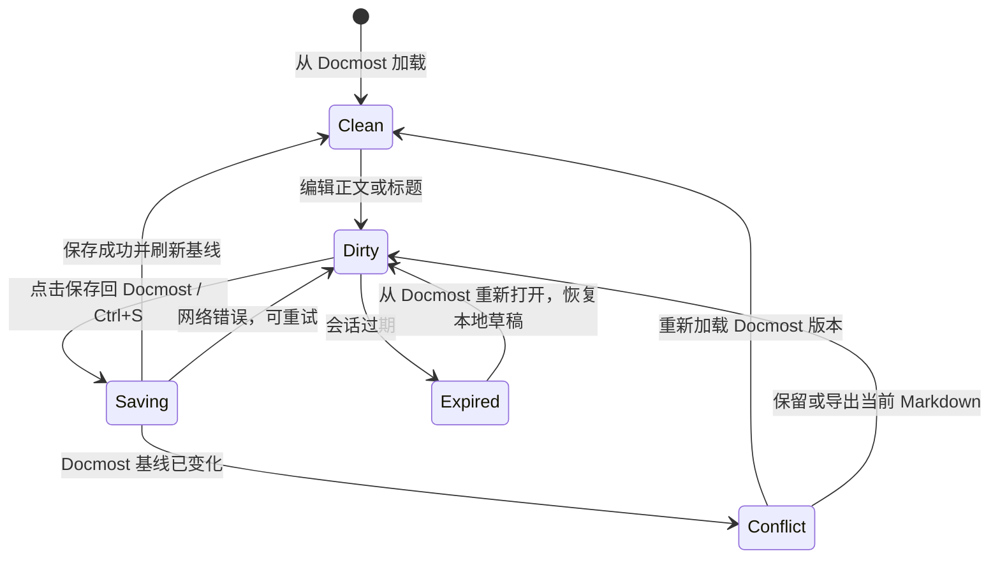

# Plan A：显式保存回 Docmost

## 决策

第一版采用“本地自动保存 + 用户显式保存回 Docmost”。Doocs 继续把编辑草稿自动存入 IndexedDB；只有用户点击“保存回 Docmost”或按 `Ctrl/Cmd+S` 时才触发远程写入。

不采用无提示的定时自动回写，因为当前 Markdown 往返存在格式损失风险，并且尚无成熟的版本冲突处理。

## 服务端设计

新增 `POST /api/integrations/doocs/content/update`，由 `DoocsSessionGuard` 保护。

请求建议：

```json
{
  "markdown": "# 正文",
  "title": "可选标题",
  "baseUpdatedAt": "2026-08-01T12:00:00.000Z",
  "baseContentHash": "sha256:..."
}
```

约束：

- `pageId` 只从 `mdSession` 读取，不接受客户端传入。
- 保存时重新调用页面权限校验，失去编辑权限后返回 403。
- 用 `baseUpdatedAt` 或内容哈希做乐观冲突检测；基线变化时返回 409，不静默覆盖。
- 复用 `PageService` 的 `format: markdown`、`operation: replace` 更新入口，通过现有协作网关写入 Yjs。
- 成功响应返回新的更新时间和内容哈希，客户端据此更新同步基线。
- `bootstrap` 增加 `canEdit`、`updatedAt`、`contentHash` 和格式兼容性信息。

## 交互状态



界面规则：

- 顶部固定显示“未修改 / 有未同步修改 / 保存中 / 已同步 / 保存失败 / 存在冲突”。
- “本地草稿已保存”不能使用“已同步”文案。
- 有未同步修改时关闭或离开页面，提示用户内容尚未写回 Docmost。
- 409 时显示冲突对话框：重新加载 Docmost 版本，或复制/下载当前 Markdown；第一版不提供一键强制覆盖。
- 会话过期时保留本地草稿，提示用户回到 Docmost 重新打开编辑器。
- 只读页面显示“只读”，禁用保存按钮。
- 检测到当前转换器不支持的 Docmost 节点时，在进入编辑和保存前给出警告；在支持矩阵明确前，优先阻止可能破坏内容的回写。

## 实现步骤

1. 扩展 bootstrap 契约，返回编辑权限、版本基线和格式兼容性。
2. 新增 Doocs 内容更新 DTO、controller 和 service，并复用 PageService/Yjs 更新路径。
3. 增加权限、会话绑定、会话过期、冲突和不支持节点测试。
4. 在 vendor Doocs 客户端增加 update API 和同步状态 store。
5. 在编辑器顶部增加保存按钮、快捷键、脏状态、冲突对话框和离开提醒。
6. 用两个浏览器窗口验证并发冲突，用包含普通富文本和自定义节点的页面验证格式保护。

## 验收标准

- 从 Docmost 打开 Doocs、编辑并显式保存后，原页面刷新可看到新正文和标题。
- 更新通过 Docmost 协作/Yjs 路径完成，已打开的 Docmost 页面能收到更新。
- mdSession 只能回写其绑定页面；无编辑权限、过期会话分别返回 403、401。
- Docmost 页面在 bootstrap 后被其他人修改时返回 409，原内容不被覆盖。
- 网络失败或会话过期时，本地草稿仍可恢复。
- 含不支持节点的页面不会在无警告情况下被破坏性覆盖。
- UI 明确区分本地保存与 Docmost 同步状态。
