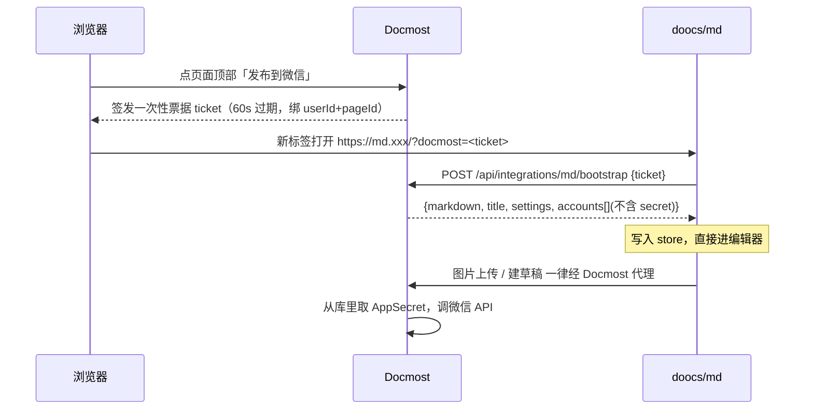

# Plan A：Docmost 为权威，doocs/md 作为受控编辑器客户端

> 编写时间：2026-07-30
> Plan Type: A

## 方案描述

配置与账号由 **Docmost 鉴权和管理**，数据落在同一 PostgreSQL 容器中的独立
`docmost_integrations` 数据库。该数据库使用独立的 Kysely 连接和迁移目录，不向
Docmost 主库 schema 增加任何表。
doocs/md 自建部署，启动时凭一次性票据向 Docmost 拉取"正文 + 该用户的配置 + 账号列表"，
写进它自己的 store；AppSecret 永不下发。

### 跳转握手

票据一次性消费，换取的响应同时带一个短期 `mdSessionToken`，后续图床代理调用用它。

### 新增库表（独立 integration 数据库，独立 Kysely migration）

| 表                       | 用途                                                            |
| ------------------------ | --------------------------------------------------------------- |
| `wechat_accounts`        | workspace_id, name, app_id, app_secret_enc, mp_id, service_type, verify, created_by |
| `md_user_settings`       | user_id, key, value(jsonb), updated_at —— 对齐 doocs 的 settings 白名单 |
| `md_integration_tickets` | ticket_hash, user_id, page_id, expires_at, consumed_at           |
| `md_integration_sessions`| session_hash, user_id, page_id, expires_at                       |

`app_secret_enc` 用 `APP_SECRET` 派生密钥做对称加密，接口一律不回显明文。

数据库隔离是硬约束：部署只保留一个 PostgreSQL 容器，由幂等初始化脚本创建
`docmost` 与 `docmost_integrations` 两个数据库；上游 Docmost 迁移仍只作用于
`docmost`。

### 前端

- Docmost 设置页新增「微信公众号」：增删改账号、填 AppID/AppSecret（只写不读）。
- 页面顶部按钮改为先请求票据再跳转，替换现在直接拼 `?pageId=` 的写法。
- doocs/md 侧新增 `modules/docmost/`：bootstrap 拉取、settings 双写回 Docmost、
  图床 provider 增加 `docmost-proxy` 一项。

## 优点

- **AppSecret 只存在于 Docmost 后端**，浏览器、doocs 前端、日志都拿不到，这是唯一
  真正满足"入库"意图的形态。
- 单一登录与权限模型：能看这个页面的人才能发它，直接复用 Docmost 的空间权限。
- 配置跟人走，换机器换浏览器都在。
- Docmost 侧改动集中在新模块，不动既有业务表。

## 缺点

- 工作量最大，且必须**维护一个 doocs/md 的 fork**（新增 bootstrap 模块、图床 provider、
  settings 回写），上游升级要手工合并。
- 多一次握手往返，跳转比现在慢。
- 图床与草稿都走 Docmost 代理，Docmost 需要新增出站到 `api.weixin.qq.com` 的能力和
  IP 白名单——原本这是 publisher 的职责，等于把职责挪了家。

## 实现步骤

1. Docmost：建立第二 Kysely 连接、独立 migrator 和三张基础表，先验证主库零污染。
2. Docmost：实现微信账号 CRUD、AppSecret 加解密与只写不读契约，再接设置页 UI。
3. Docmost：实现一次性票据、bootstrap、短期 mdSession 与 settings 读写。
4. Docmost：实现微信图床服务端代理；页面顶部入口改为「先要票据再跳转」。
5. fork doocs/md → `apps/md`（或独立仓库），依次接 bootstrap、settings 回写和
   `docmost-proxy` 图床。
6. compose 接入 doocs 服务并做两库隔离、跨浏览器配置与无密钥网络请求联调。
7. publisher 的账号来源从 env 改为读 `wechat_accounts`，作为兼容收尾；真实微信
   凭据与出口 IP 验收继续由 DOCMOST-19 承担。

## 预估工作量

大。Docmost 后端 3～4 天，doocs/md fork 改造 3～5 天，联调与部署 2 天。
