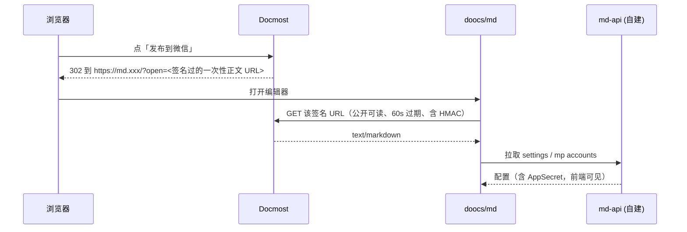

# Plan B：自建 @md/api 换 Postgres，作为配置与账号的唯一库

> 编写时间：2026-07-30
> Plan Type: B

## 方案描述

不动 Docmost 后端。把 doocs 自带的 `apps/api`（Hono + Cloudflare D1）改造成
**Node + Postgres** 自建服务，扩展它的 settings 同步白名单，把 `mpConfig` 和
`mpAccounts` 纳入同步范围（加密列），成为账号与配置的唯一权威库。
Docmost 只负责"把正文送过去"。

### 跳转握手

沿用 doocs 现成的 deep link，但正文不走浏览器直连：

正文用**签名 URL** 而不是票据握手：Docmost 加一个 `GET /api/pages/raw?token=<hmac>`，
无需登录、只在有效期内、只放行单个 pageId。这样 `?open=` 那条现成通路能直接复用，
CORS 只需要放行 md 的 origin。

### 改造点

| 位置                            | 改动                                                     |
| ------------------------------- | -------------------------------------------------------- |
| `apps/api/src/db.ts`            | D1 → `pg`/Kysely，重写 6 个 migration 为 Postgres SQL     |
| `apps/api/src/auth.ts`          | GitHub OAuth → 换成 Docmost OIDC 或简单共享密钥           |
| `apps/api/src/sync.ts`          | settings 白名单加入 `mpConfig`、`mp-accounts`，列级加密   |
| Docmost                         | 新增签名正文接口 + 顶部按钮改为跳 `?open=`                |

## 优点

- **Docmost 侧改动最小**：一个签名接口 + 改按钮的目标 URL，业务代码基本不碰。
- 复用 doocs 现成的同步协议（LWW + 游标增量），不用自己设计配置同步。
- doocs/md 的 fork 改动比 A 小很多，主要在 api 层，web 层几乎原样。
- 配置天然跨设备，且 doocs 的桌面端/VSCode 插件也能共用同一份配置。

## 缺点

- **AppSecret 仍会下发到浏览器**。它入了库、跨设备了，但"别让前端拿到密钥"这个目标
  没达成，只是从 IndexedDB 变成"从服务器取来再放进 IndexedDB"。如果用户的真实诉求
  包含安全，这条是硬伤。
- 多一套后端要运维（md-api + 它的库），账号体系与 Docmost 分裂，权限对不上——
  能打开 md 的人能看到所有公众号配置。
- 签名 URL 是一个匿名可读的正文出口，即使短期有效，也扩大了攻击面。
- D1(SQLite) → Postgres 的 SQL 方言与 Worker API 迁移是实打实的体力活。

## 实现步骤

1. `apps/api` 脱 Cloudflare：Hono 换 Node adapter，D1 换 pg，重写 migrations。
2. 认证换成与 Docmost 共享的方式。
3. 扩展 settings 白名单 + 加密列 + 前端 `stores/mpAccounts.ts` 接入同步。
4. Docmost 加签名正文接口，改顶部按钮跳 `?open=`。
5. 部署 md-web + md-api + 库。

## 预估工作量

中。api 改造 3～4 天，同步白名单与加密 1～2 天，Docmost 侧 1 天，部署联调 1～2 天。
