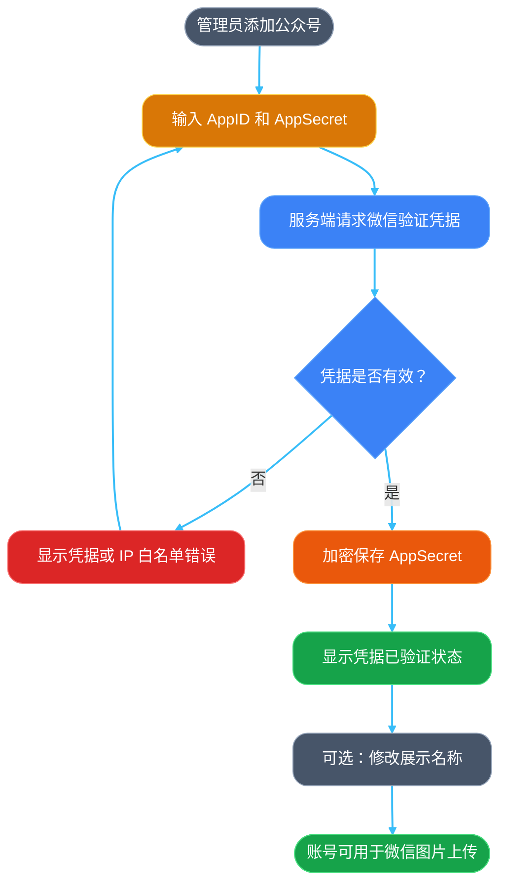

# Plan A: verified manual AppID/AppSecret setup

## Interaction

The modal has two required fields: AppID and AppSecret. Submission validates the credentials against WeChat before the encrypted secret is stored. Account naming becomes optional metadata that can be edited after creation. The manually controlled authenticated switch is removed.

## Data and compatibility

- Keep the existing AppID/AppSecret credential mode.
- Preserve encrypted-at-rest and never-return-secret behavior.
- Distinguish "credential validation" from the official account's WeChat verification category.
- Existing accounts continue to work and can be revalidated explicitly.

## Validation

- Component tests cover the reduced form and the absence of a manual authenticated switch.
- Server tests cover valid credentials, invalid credentials, IP allowlist errors, encryption, and secret redaction.
- Existing account and image upload tests remain green.
