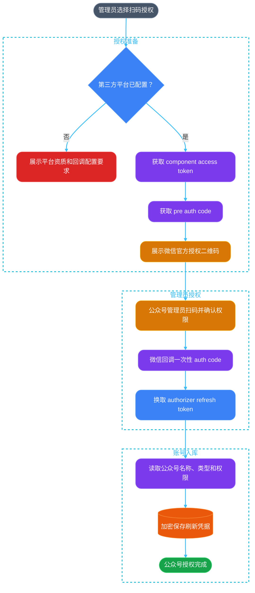

# Plan A: official third-party-platform QR authorization

## Prerequisites

- An approved WeChat Open Platform third-party platform.
- Component AppID and AppSecret configured server-side.
- Public HTTPS endpoints for authorization events and authorization callbacks.
- Encrypted storage for component and authorizer refresh credentials.
- Declared permissions that cover the WeChat APIs Docmost intends to call.

## Interaction

## Credential modes

The account model must distinguish:

- `manual_secret`: AppID plus encrypted AppSecret.
- `open_platform`: authorizer AppID plus encrypted authorizer refresh token and granted scopes.

The upload service obtains a current access token from the appropriate credential provider. Manual onboarding remains available as a fallback.

## Failure and lifecycle states

- Platform not configured: QR entry is disabled with prerequisites.
- QR expired: regenerate a pre-authorization code without losing the settings page state.
- Authorization denied or callback invalid: do not create an account.
- Authorization revoked: mark the account disconnected and stop token refresh.
- Granted scopes insufficient: show the missing capability rather than treating the account as fully usable.
